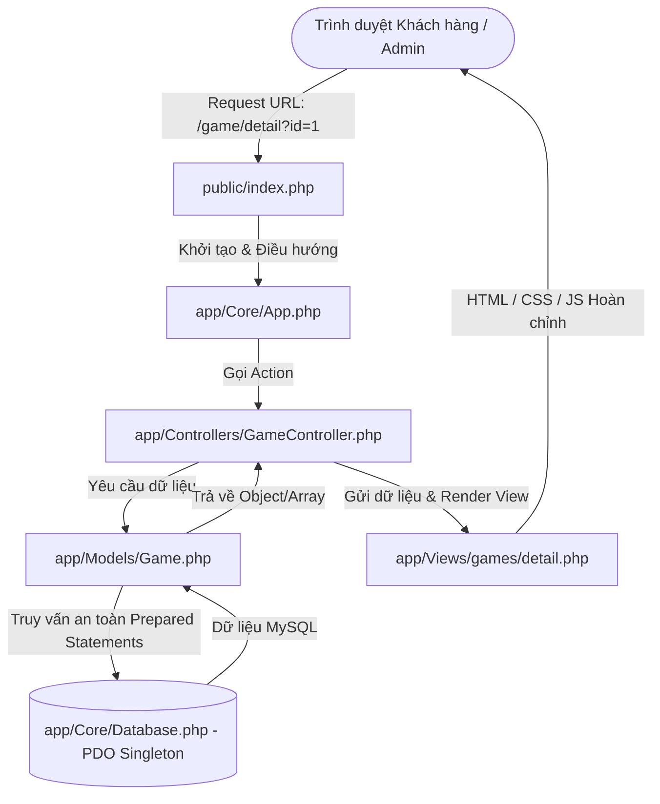
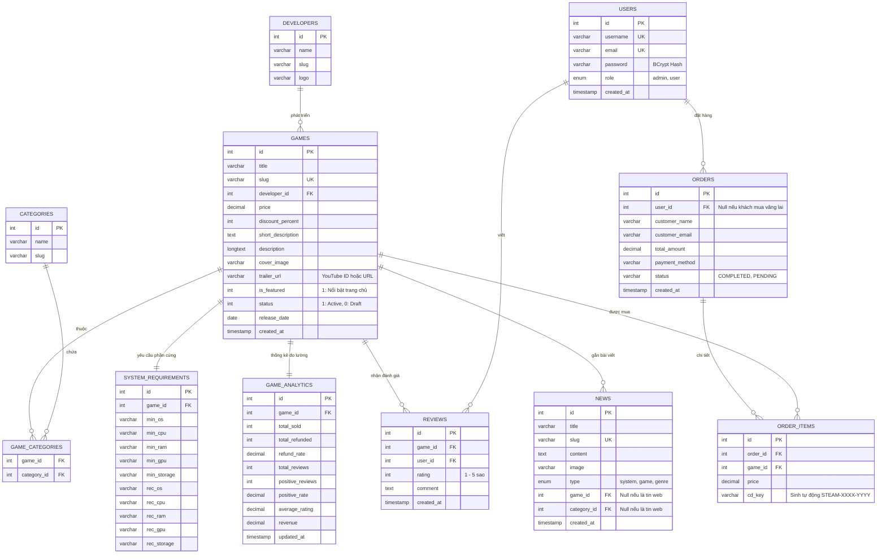

# TAI LIEU KIEN TRUC VA XAY DUNG DU AN GAME SHOP
> **Đồ án:** Website Kinh Doanh Game Bản Quyền & Tin Tức Trò Chơi  
> **Phong cách Giao diện:** Gaming Dark Theme (Cảm hứng từ **Steam** & **Epic Games Store**)  
> **Mô hình Kiến trúc:** **Pure PHP MVC** (Model - View - Controller) không dùng framework cồng kềnh, chuẩn bảo mật PDO, tương thích 100% XAMPP.

---

## 0. CASE STUDY: HIỆN TRẠNG WEB CŨ & CHIẾN LƯỢC NÂNG CẤP (LEGACY AUDIT & MIGRATION)

> **Mục đích phần này:** Cung cấp đầy đủ bối cảnh xuất phát điểm của dự án để bất kỳ Kỹ sư hoặc Hệ thống AI nào tiếp nhận đều hiểu rõ gốc rễ mã nguồn cũ, nguyên nhân cần tái cấu trúc và cách tái sử dụng tài nguyên hiện có.

### 0.1. Kiểm Tra & Đánh Giá Web Cũ (Legacy Codebase Audit)
1. **Kiến trúc cũ (Procedural PHP):**
   - Trang chủ [index.php](file:///c:/xampp/htdocs/game_shop/index.php) gọi các thành phần con bằng `include 'sections/...';` (`banner_video.php`, `news.php`, `games.php`, `media_gallery.php`).
   - Các trang chức năng nằm trong [pages/](file:///c:/xampp/htdocs/game_shop/pages/) (`cart.php`, `login.php`, `register.php`) viết theo kiểu trộn lẫn mã PHP, HTML và câu lệnh SQL trực tiếp.
   - Kết nối CSDL [db.php](file:///c:/xampp/htdocs/game_shop/db.php) sử dụng thư viện `mysqli_connect` kết nối Database `game_store`.
2. **Cơ sở dữ liệu cũ (Legacy DB):**
   - Database `game_store` chỉ có 4 bảng đơn sơ: `games` (4 tựa game), `news` (2 tin), `galleries` (3 slide), `users` (tài khoản mẫu).
   - Mật khẩu lưu dạng văn bản thô (Plain-text) không băm; các câu truy vấn nối chuỗi trực tiếp `$sql = "... WHERE id='$id'"` tiềm ẩn lỗ hổng nghiêm trọng về **SQL Injection**.
3. **Tài nguyên Media sẵn có (Assets Inventory):**
   - Đã có sẵn video nền [banner_video.mp4](file:///c:/xampp/htdocs/game_shop/media/video/banner_video.mp4) (108MB).
   - Đã có sẵn poster bìa 4 tựa game nổi tiếng trong `media/img/games/` (`elden_ring.jpg`, `cyberpunk.jpg`, `gow.jpg`, `fc24.jpg`).
   - Đã có sẵn ảnh chụp màn hình trong `media/img/galleries/` và ảnh tin tức trong `media/img/news/`.
4. **Hạn chế lớn cần giải quyết:**
   - Chưa có trang Chi tiết từng Game (chưa có video trailer, cấu hình máy, tags, đánh giá).
   - Chưa có trang Quản trị Admin (mọi thao tác phải sửa tay trong phpMyAdmin).
   - Chưa có phân loại thể loại game, chưa có chức năng lọc & tìm kiếm nâng cao.
   - Giỏ hàng chỉ lưu mảng ID đơn giản trong Session, chưa có bảng đơn hàng lưu CD-Key.

### 0.2. Chiến Lược Nâng Cấp & Tái Sử Dụng (Migration Strategy)
- **Tái sử dụng tài nguyên cũ:** Di chuyển toàn bộ ảnh game và video trong `media/` vào `public/assets/media/` để làm dữ liệu khởi đầu cho web mới.
- **Nâng cấp CSDL:** Mở rộng từ 4 bảng cũ lên 10 bảng chuẩn hóa 3NF (`docs/upgrade_database.sql`), giữ lại dữ liệu 4 game cũ và nạp thêm các trường cấu hình máy, trailer, analytics.
- **Thay thế hoàn toàn cấu trúc code:** Đóng gói toàn bộ logic vào mô hình **Pure PHP MVC** chuẩn hóa, chuyển đổi từ `mysqli` sang **PDO Singleton** và bảo mật mật khẩu với `password_hash(..., PASSWORD_BCRYPT)`.

### 0.3. Quy Tắc Bắt Buộc Cho Các AI Khi Phát Triển Tiếp (Mandatory AI Rules)
1. **Không dùng Framework nặng ngoài (No Laravel / No Symfony / No Composer packages):** Đây là đồ án sinh viên môn Lập trình Web, toàn bộ mã nguồn phải là **Pure PHP MVC** thuần túy để giảng viên dễ duyệt và chạy trực tiếp trên XAMPP Windows mà không cần cài đặt môi trường phức tạp.
2. **Bảo mật tuyệt đối (100% Prepared Statements):** Mọi câu lệnh SELECT/INSERT/UPDATE/DELETE phải dùng PDO Prepared Statements với tham số ràng buộc `bindValue()` hoặc mảng `execute([$param])`.
3. **Thực hiện tuần tự theo Roadmap:** Bắt buộc tuân thủ đúng danh mục công việc trong [STAGE_DEVELOPMENT.md](file:///c:/xampp/htdocs/game_shop/docs/STAGE_DEVELOPMENT.md).

---

## 1. TỔNG QUAN DỰ ÁN

### 1.1. Mục tiêu
Xây dựng một website thương mại điện tử chuyên nghiệp phục vụ kinh doanh sản phẩm trò chơi điện tử (Game Store), tích hợp cổng thông tin tin tức game, bảng xếp hạng doanh số và phân hệ quản trị (Admin Portal) toàn diện, đáp ứng hoàn hảo tiêu chí đồ án môn học Lập trình Web.

### 1.2. Đối tượng sử dụng
1. **Khách hàng (User/Customer):**
   - Khám phá các tựa game nổi bật, bán chạy, mới ra mắt hoặc miễn phí.
   - Tìm kiếm game theo tên hoặc studio phát triển, lọc đa tầng theo thể loại và mức giá.
   - Xem chi tiết game: trailer, ảnh chụp màn hình, bảng cấu hình máy tính (Min/Rec), đánh giá cộng đồng, tin tức liên quan.
   - Xem bảng xếp hạng doanh số (Steam Charts), tỷ lệ hoàn trả và mức độ hài lòng.
   - Thêm vào giỏ hàng, thanh toán mô phỏng VietQR và nhận mã CD-Key bản quyền tự động.
   - Chuyển đổi ngôn ngữ (Tiếng Việt / English) và giao diện Sáng / Tối (Dark / Light Theme).
2. **Quản trị viên (Administrator):**
   - Toàn quyền kiểm soát và vận hành hệ thống thông qua trang Dashboard quản trị (`/admin`).
   - Quản trị Games (Thêm/Sửa/Xóa, tải ảnh bìa, nhập cấu hình phần cứng, link trailer, phân loại thể loại & studio).
   - Quản trị Tin tức (Đăng bài tin tức web, tin theo từng game, tin theo thể loại).
   - Quản trị Danh mục Thể loại & Studio nhà phát triển.
   - Quản trị Tài khoản người dùng (Phân quyền Admin/User, đổi mật khẩu an toàn).
   - Theo dõi Đơn hàng & Thống kê doanh thu.

---

## 2. KIẾN TRÚC PHẦN MỀM: PURE PHP MVC PATTERN

Hệ thống tuân thủ nghiêm ngặt mô hình **MVC (Model - View - Controller)** kết hợp **Front Controller Router** và **PDO Singleton Pattern**:



### 2.1. Cấu Trúc Thư Mục Chuẩn Hóa
```text
game_shop/
├── app/
│   ├── Config/
│   │   └── config.php               # Hằng số hệ thống, CSDL, Base URL
│   ├── Core/                        # Bộ khung cốt lõi MVC
│   │   ├── App.php                  # Router Front Controller
│   │   ├── Controller.php           # Base Controller (render view, nạp model)
│   │   ├── Database.php             # PDO Singleton Connection
│   │   └── Model.php                # Base Model với các hàm CRUD tái sử dụng
│   ├── Controllers/
│   │   ├── HomeController.php       # Điều khiển Trang chủ
│   │   ├── GameController.php       # Chi tiết game, Catalog & Lọc game
│   │   ├── RankingController.php    # Bảng xếp hạng Steam Charts
│   │   ├── NewsController.php       # Tin tức tổng hợp
│   │   ├── CartController.php       # Giỏ hàng & Thanh toán
│   │   ├── AuthController.php       # Đăng nhập, Đăng ký, Đăng xuất
│   │   └── AdminController.php      # Trung tâm quản trị toàn diện
│   ├── Models/
│   │   ├── Game.php
│   │   ├── Developer.php
│   │   ├── Category.php
│   │   ├── SystemRequirement.php
│   │   ├── GameAnalytics.php
│   │   ├── News.php
│   │   ├── User.php
│   │   └── Order.php
│   ├── Views/
│   │   ├── layouts/
│   │   │   ├── main.php             # Khung giao diện Gaming cho khách
│   │   │   └── admin.php            # Khung giao diện Admin Portal
│   │   ├── partials/
│   │   │   ├── header.php           # Header, Menu, Search, Theme/Lang Switcher
│   │   │   ├── footer.php           # Footer Gaming
│   │   │   └── admin_sidebar.php    # Menu điều hướng Admin
│   │   ├── home/index.php           # Trang chủ (Spotlight, Top Sellers, New...)
│   │   ├── games/
│   │   │   ├── catalog.php          # Cửa hàng lọc game Epic style
│   │   │   └── detail.php           # Chi tiết game Steam style
│   │   ├── rankings/index.php       # Bảng xếp hạng Leaderboard
│   │   ├── news/
│   │   │   ├── index.php            # Danh sách tin tức đa bộ lọc
│   │   │   └── detail.php           # Đọc chi tiết bài viết
│   │   ├── cart/
│   │   │   ├── index.php            # Giỏ hàng
│   │   │   └── checkout.php         # Thanh toán VietQR & Cấp CD-Key
│   │   ├── auth/
│   │   │   ├── login.php
│   │   │   └── register.php
│   │   └── admin/
│   │       ├── dashboard.php        # Thống kê tổng quan
│   │       ├── games/               # Danh sách, Thêm, Sửa games
│   │       ├── news/                # Danh sách, Thêm, Sửa tin tức
│   │       ├── categories/          # Quản lý thể loại
│   │       ├── developers/          # Quản lý studio
│   │       ├── users/               # Quản lý người dùng
│   │       └── orders/              # Quản lý đơn hàng & CD-Key
│   └── Lang/
│       ├── vi.php                   # Bộ từ điển Tiếng Việt
│       └── en.php                   # Bộ từ điển Tiếng Anh
├── public/
│   ├── index.php                    # Điểm vào duy nhất
│   ├── .htaccess                    # Rewrite URL
│   └── assets/
│       ├── css/                     # CSS module Gaming
│       ├── js/                      # JS tương tác (Slider, Search, Theme, Tabs)
│       └── uploads/                 # Ảnh game, tin tức do Admin tải lên
└── docs/
    ├── stonk_games_store.sql        # Script CSDL đầy đủ 10 bảng chuẩn hóa 3NF
    ├── PROJECT_ARCHITECTURE.md      # Tài liệu này
    └── STAGE_DEVELOPMENT.md         # Kế hoạch phát triển từng giai đoạn
```

### 2.2. Bảng Đặc Tả Routing & Điều Hướng (URL Mapping)
Hệ thống hỗ trợ 2 dạng URL: Clean URL (nhờ `.htaccess` dạng `domain/game/detail?id=1`) và Standard URL tương thích mọi môi trường XAMPP (dạng `domain/index.php?url=game/detail&id=1`):

| URL Route | HTTP Method | Controller & Action | Chức năng nghiệp vụ |
| :--- | :---: | :--- | :--- |
| `/` hoặc `/home` | GET | `HomeController@index` | Trang chủ Storefront (Spotlight, Top Sellers, New...) |
| `/game/detail` | GET | `GameController@detail` | Trang chi tiết game (Trailer, Cấu hình, Reviews...) |
| `/catalog` | GET | `GameController@catalog` | Cửa hàng Epic style (Tìm kiếm kép + Bộ lọc đa tầng) |
| `/rankings` | GET | `RankingController@index` | Bảng xếp hạng Steam Charts (Top bán chạy, top thể loại) |
| `/news` | GET | `NewsController@index` | Danh sách tin tức có lọc theo web / game / thể loại |
| `/news/detail` | GET | `NewsController@detail` | Xem bài viết tin tức chi tiết |
| `/cart` | GET | `CartController@index` | Xem giỏ hàng |
| `/cart/add` | POST/GET | `CartController@add` | Thêm game vào giỏ hàng |
| `/cart/remove` | GET | `CartController@remove` | Xóa game khỏi giỏ hàng |
| `/checkout` | GET/POST | `CartController@checkout` | Điền email, tạo VietQR, cấp CD-Key & tạo đơn hàng |
| `/auth/login` | GET/POST | `AuthController@login` | Đăng nhập tài khoản |
| `/auth/register` | GET/POST | `AuthController@register` | Đăng ký tài khoản người dùng |
| `/auth/logout` | GET | `AuthController@logout` | Đăng xuất phiên làm việc |
| `/admin` | GET | `AdminController@dashboard` | Dashboard quản trị tổng quan |
| `/admin/games` | GET | `AdminController@games` | Danh sách quản lý Games |
| `/admin/games/create` | GET/POST | `AdminController@createGame`| Thêm game mới (ảnh, trailer, cấu hình min/rec) |
| `/admin/games/edit` | GET/POST | `AdminController@editGame`  | Sửa thông tin game |
| `/admin/games/delete`| POST/GET | `AdminController@deleteGame`| Xóa game |
| `/admin/news` | GET | `AdminController@news` | Danh sách quản lý Tin tức |
| `/admin/news/create` | GET/POST | `AdminController@createNews`| Đăng tin mới |
| `/admin/news/edit` | GET/POST | `AdminController@editNews`  | Sửa bài viết |
| `/admin/news/delete` | POST/GET | `AdminController@deleteNews`| Xóa bài viết |
| `/admin/categories` | GET/POST | `AdminController@categories`| Quản lý danh mục thể loại (CRUD) |
| `/admin/developers` | GET/POST | `AdminController@developers`| Quản lý Studio nhà phát triển (CRUD) |
| `/admin/users` | GET/POST | `AdminController@users`     | Quản lý tài khoản & phân quyền (CRUD) |
| `/admin/orders` | GET | `AdminController@orders`    | Quản lý đơn hàng & mã CD-Key |

---

## 3. THIẾT KẾ CƠ SỞ DỮ LIỆU (DATABASE SCHEMA)

Cơ sở dữ liệu `game_store` được thiết kế chuẩn hóa 3NF, liên kết chặt chẽ qua Foreign Keys:



---

## 4. CHI TIẾT CÁC PHÂN HỆ CHỨC NĂNG

### 4.1. Trang Chủ (Storefront)
- **Hero Spotlight Carousel:** Slider tương tác kiểu Steam, kết hợp Video trailer và 4 ảnh thumbnail phụ, hiển thị tag thể loại, giá và mức giảm giá.
- **Top Game Bán Chạy:** Xếp hạng lấy từ `game_analytics.total_sold`.
- **Games Mới Phát Hành:** Lấy theo `games.release_date`.
- **Games Miễn Phí (Free-to-play):** Lọc các game có `price = 0`.
- **Tin tức mới theo game:** Tin tức mới nhất gắn liền với các tựa game hot.

### 4.2. Trang Chi Tiết Sản Phẩm (Game Page)
- Trình chiếu Trailer YouTube & Screenshots.
- Thông tin nhà phát triển, ngày ra mắt, hệ thống Tags bấm được.
- **Bảng Cấu hình máy tính:** Đối chiếu Tối thiểu & Đề nghị.
- **Mục Đánh giá (Reviews):** Điểm số và bình luận từ người chơi.
- **Bản tin cập nhật riêng:** Danh sách các thông báo/patch notes thuộc về game đó.

### 4.3. Cửa Hàng & Bộ Lọc Nâng Cao (Catalog - Epic Games Style)
- Thanh tìm kiếm kép: Tìm theo **Tên Game** hoặc **Tên Studio**.
- Bộ lọc sidebar: Thể loại, Mức giá (Free, <200k, <500k...), Sắp xếp (Giá tăng/giảm, Bán chạy, Đánh giá cao).

### 4.4. Trang Bảng Xếp Hạng (Steam Charts / Leaderboard)
- Tab 1: Bán chạy toàn sàn (xếp hạng 1, 2, 3 với huy hiệu Vàng, Bạc, Đồng).
- Tab 2: Top game theo từng danh mục thể loại.
- Bảng hiển thị các chỉ số: Số bản đã bán, Tỷ lệ hoàn trả (`refund_rate`), Mức độ hài lòng (`positive_rate`).
- Click vào game chuyển hướng ngay đến trang chi tiết.

### 4.5. Phân Hệ Quản Trị Admin Trung Tâm (`/admin`)
- **Dashboard:** Thống kê số game, bài viết, tài khoản, doanh thu.
- **CRUD Games:** Thêm/Sửa/Xóa game, tải ảnh, nhập cấu hình, link trailer, gán thể loại & studio.
- **CRUD Tin tức:** Đăng tin web, tin theo game, tin theo thể loại.
- **CRUD Thể loại & Studio:** Quản lý danh mục.
- **CRUD Người dùng:** Quản lý tài khoản, phân quyền.
- **Quản lý Đơn hàng:** Xem mã CD-Key đã cấp, doanh thu.

### 4.6. Tiện Ích Giao Diện & Quy Chuẩn Chuyển Ngữ
- **Chế độ Sáng / Tối (Dark / Light Theme):** Lưu cấu hình trong `localStorage`.
- **Đa Ngôn Ngữ Hệ Thống (VI / EN):**
  - Quản lý từ điển hệ thống qua `app/Lang/vi.php` và `app/Lang/en.php`, truy xuất qua helper `__('key')`.
  - **Quy tắc bắt buộc:** Chuyển ngữ chỉ áp dụng cho các nút chức năng, nhãn điều hướng và tiêu đề hệ thống. Toàn bộ dữ liệu Games (tên, mô tả, cấu hình) và Tin tức (News) được lưu trữ và hiển thị bằng tiếng Anh chuẩn (English).
- **Quy chuẩn Định danh:** Tuyệt đối không sử dụng icon hay emoji trong mã nguồn, tên module, tiêu đề và nhãn giao diện hệ thống.
